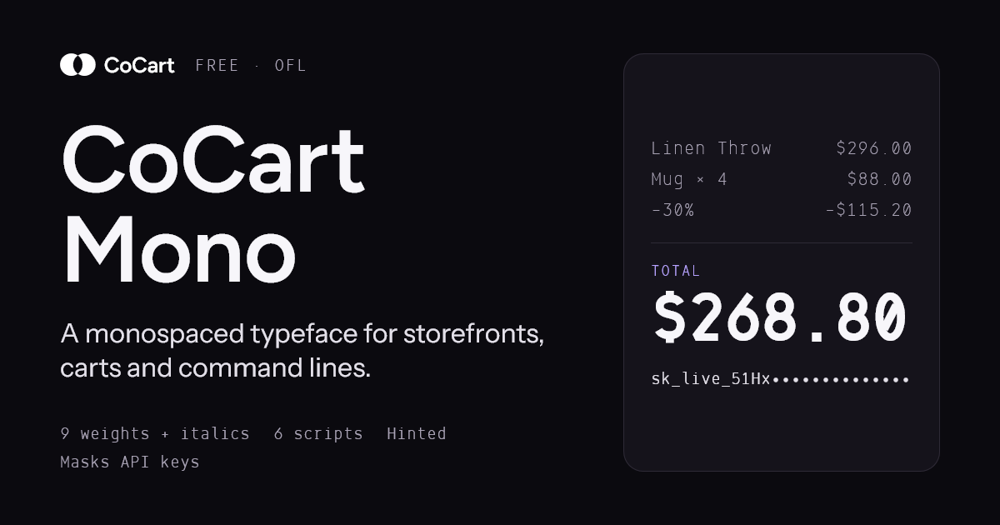

# CoCart Mono

[](https://github.com/cocart-headless/cocart-mono-font/releases/latest)
[](https://github.com/cocart-headless/cocart-mono-font/actions/workflows/validate.yml)
[](OFL.txt)

A free monospaced typeface for storefronts, carts and command lines.



**[Specimen](https://cocart-headless.github.io/cocart-mono-font/)** · **[Languages](https://cocart-headless.github.io/cocart-mono-font/languages.html)** · **[Download](https://github.com/cocart-headless/cocart-mono-font/releases/latest)** · **[Changelog](CHANGELOG.md)** · **[Report an issue](https://github.com/cocart-headless/cocart-mono-font/issues/new/choose)**

- **Nine weights, one skeleton.** Thin 100 to Black 900, each with a true italic, plus a variable font for every weight in between. Each glyph is drawn as a single centre line and weighted last, so figures and grids never shift between weights.
- **One cell for every glyph.** Every character is 600 units wide on a 1000-unit em. Prices line up on the decimal point without tabular settings.
- **40 languages in six scripts, on the same grid.** Latin (including Vietnamese and Welsh), Cyrillic, Greek, Thai, Armenian and Georgian.
- **Look-alikes drawn apart.** 0 and O, 1, l and I, 5 and S, 8 and B, and rn and m stay distinct, so SKUs and coupon codes read right the first time.
- **Built for terminals.** Full box drawing and block elements, all 256 Braille patterns, every currency sign up to ₿, and the marks AI coding agents print (✻ ⏺ ⎿ ❯ ◐).
- **Keeps a secret.** Turn on `ss02`, or install CoCart Mono Masked, and API keys show as dots on screen while the text itself stays intact.
- **Hinted.** The static TrueType files carry hinting, so 11–14px prices stay sharp on Windows.

## Install

### Desktop

Download `CoCart-Mono-<version>.zip` from the [latest release](https://github.com/cocart-headless/cocart-mono-font/releases/latest) and install the two files in `CoCart-Mono/ttf/variable`:

| | |
| --- | --- |
| **macOS** | Select both `.ttf` files, double-click, then **Install**. |
| **Windows** | Select both `.ttf` files, right-click, then **Install for all users**. For text at 11–14px, install `ttf/static` instead: those files carry the ClearType hinting. |
| **Linux** | Copy `ttf/variable` into `~/.local/share/fonts`, then run `fc-cache -f`. |

Restart your terminal or editor afterwards.

### One line (macOS and Linux)

```sh
curl -fsSL https://cocart-headless.github.io/cocart-mono-font/install.sh | sh
```

The script downloads the latest release, checks it against the SHA-256 published with the release, then copies CoCart Mono and CoCart Mono Masked (variable, roman and italic) into your user fonts folder. It doesn't need sudo. [Read it first](install.sh). To pin a version, run `COCART_MONO_VERSION=1.0.0 sh` instead of `sh`.

### What's in the zip

```text
CoCart-Mono-1.0.0/
├─ CoCart-Mono/
│  ├─ ttf/variable    2   Roman and Italic, wght 100–900
│  ├─ ttf/static     18   every weight, hinted
│  ├─ ttf/scripts    54   Thai, Armenian and Georgian
│  └─ woff2          74   with two stylesheets
├─ CoCart-Mono-Masked/    the same drawings, masking always on
├─ OFL.txt
└─ README.txt
```

## Use it on the web

Copy `fonts/woff2/`, `fonts/variable/` and `fonts/css/` from this repository into your site, keeping the folder names. Then link a stylesheet:

```html
<link rel="preload" href="/fonts/woff2/CoCart-Mono-Regular.woff2" as="font" type="font/woff2" crossorigin>
<link rel="stylesheet" href="/fonts/css/cocart-mono.css">

<style>
  .price, .sku, .order-number, code, pre {
    font-family: "CoCart Mono", ui-monospace, monospace;
  }
</style>
```

| Stylesheet | Family | What it loads |
| --- | --- | --- |
| `cocart-mono.css` | `CoCart Mono` | Nine weights and italics. Thai, Armenian and Georgian load only when a page uses them (`unicode-range`). |
| `cocart-mono-variable.css` | `CoCart Mono VF` | Two variable files, roman and italic, with weights 100–900. |
| `cocart-mono-masked.css` | `CoCart Mono Masked`, `CoCart Mono Masked VF` | The masked build, static and variable. |

A static style is about 75 KB as WOFF2, and a variable file about 203 KB. Each stylesheet lists WOFF2 first and falls back to TTF.

Or install the package with your package manager:

| Package manager | Command |
| --- | --- |
| npm | `npm install @cocartheadless/mono` |
| Yarn | `yarn add @cocartheadless/mono` |
| pnpm | `pnpm add @cocartheadless/mono` |
| Bun | `bun add @cocartheadless/mono` |

Then import a stylesheet in your entry file:

```js
import "@cocartheadless/mono";                 // cocart-mono.css
import "@cocartheadless/mono/variable.css";    // cocart-mono-variable.css
import "@cocartheadless/mono/masked.css";      // cocart-mono-masked.css
```

The package holds the WOFF2 files and the three stylesheets (WOFF2 only, no TTF fallback), about 5 MB unpacked. The full paths, such as `@cocartheadless/mono/dist/cocart-mono.css`, work too.

For Next.js, `@cocartheadless/mono/next` exports a `next/font/local` loader for the variable fonts, so they're self-hosted and preloaded:

```tsx
// app/layout.tsx
import { cocartMono } from "@cocartheadless/mono/next";

export default function RootLayout({ children }) {
  return <html lang="en" className={cocartMono.variable}><body>{children}</body></html>;
}
// then, in CSS: font-family: var(--font-cocart-mono);
```

Or skip installing and load it from jsDelivr, which serves the npm package. Pin at least the major version:

```html
<link rel="stylesheet" href="https://cdn.jsdelivr.net/npm/@cocartheadless/mono@1/dist/cocart-mono.css">
```

Swap the file name for `cocart-mono-variable.css` or `cocart-mono-masked.css` to load the other families. `https://unpkg.com/@cocartheadless/mono@1/dist/…` works the same way.

## OpenType features

| Feature | What it does |
| --- | --- |
| `zero`, `ss01` | Dotted zero instead of the slashed default |
| `ss02` | Masks API keys and tokens on screen (see below) |
| `ccmp` | Composes accents typed as separate marks, so decomposed Vietnamese or Lithuanian still gets the drawn letter |

```css
.secret { font-feature-settings: "ss02" 1; }
.dotted { font-feature-settings: "zero" 1; }
```

## Key masking

Paste a WooCommerce consumer secret during a screen share, and the people watching see this:

```text
WOO_CONSUMER_SECRET=cs_9b8a••••••••••••••••••••••••••••••••••••
```

The clipboard, the file and your shell history keep every character. The font does this by itself: no plugin, and nothing the app needs to know about.

- **How it works.** The font recognises key prefixes such as `ck_`, `cs_`, `sk_live_`, `whsec_` and `glpat-`, context words such as `token`, `consumer_secret` and `AUTH_KEY`, and contexts such as `Bearer ` and `--token `. The first four characters after a prefix stay readable, so you can still tell keys apart.
- **Two ways to turn it on.** Use `ss02` in CoCart Mono, or install **CoCart Mono Masked**, which has masking always on for apps without font-feature settings.
- **Keep it off the storefront.** Masking hides text from shoppers too, so use it only for docs, dashboards, terminals and screen recordings.
- **It's a visual aid, not a security control.** The secret is still in the text, so anyone can copy it, and an unusual format may not be recognised. If masking missed a key or masked normal text, [open a masking issue](https://github.com/cocart-headless/cocart-mono-font/issues/new?template=masking.yml). Use a fake key in the report, never a real one.

## Families and files

| Family | Weights | Formats | Notes |
| --- | --- | --- | --- |
| CoCart Mono | 100–900 + italics | OTF, TTF, WOFF2, variable | Latin, Cyrillic, Greek and symbols; the variable font also includes Thai |
| CoCart Mono Masked | 100–900 + italics | OTF, TTF, WOFF2, variable | Same drawings, key masking always on |
| CoCart Mono Thai / Armenian / Georgian | 100–900 + italics | OTF, TTF, WOFF2 | Per-script static files; the stylesheet loads them on demand |

Weights: Thin 100 · ExtraLight 200 · Light 300 · Regular 400 · Medium 500 · SemiBold 600 · Bold 700 · ExtraBold 800 · Black 900.

Metrics: 1000-unit em · 600-unit cell · ascender 760 · cap height 700 · x-height 530 · descender −210 · italic angle 9°. Use a line height of 1.2 or more, and 13px or larger for body text. At 11–12px, use Medium or SemiBold.

## Languages and native reviews

The [languages page](https://cocart-headless.github.io/cocart-mono-font/languages.html) lists the 40 languages CoCart Mono covers. For each one it shows whether every letter is there, whether a native reader has reviewed it yet, and a text box to try your own words.

Tests can show that a letter exists and fits the cell. Only someone who reads the language every day can say whether it looks right. If that's you:

1. Open the languages page, pick your language and download its fillable PDF review sheet.
2. Fill it in with any PDF reader. You don't need design knowledge.
3. Send it with the [Native review form](https://github.com/cocart-headless/cocart-mono-font/issues/new?template=native-review.yml), or email it to hello@cocartheadless.com if you don't have a GitHub account.

Reviews aren't credited by name. If your review leads to a fix and you'd like credit, say so and you'll be listed in the release notes.

If one letter is wrong, **Something looks wrong?** on the languages page opens an issue with the language already filled in.

## Repository

```text
fonts/
  otf/        static OpenType (CFF)
  ttf/        static TrueType, hinted
  woff2/      static web fonts
  variable/   variable TTF and WOFF2
  css/        @font-face stylesheets
site/         the specimen, languages and review pages, deployed to GitHub Pages
  review-sheets/        fillable PDF review sheet for each language
  mono-languages.json   coverage and review status shown on the languages page
scripts/      checks, the release zip builder and the site builder
install.sh    the one-line installer
```

This repository holds the built fonts. The sources and build pipeline live elsewhere, so a glyph fix goes in as an issue, not a pull request against the binaries. Each pull request runs these checks:

- **Fonts:** every expected file exists and opens, names and weights match the file name, every glyph sits on the 600-unit cell, versions match, WOFF2 and OTF cover the same characters as their TTF, and the stylesheets resolve.
- **Site:** the page is assembled and every local link is checked.
- **Lint:** workflows (actionlint) and the installer (shellcheck).
- **Font Bakery:** an informational report on the variable fonts.

Pushing a `v*.*.*` tag builds a reproducible zip, writes its SHA-256 and publishes a GitHub release, with notes taken from [CHANGELOG.md](CHANGELOG.md).

## Contributing

Bug reports, glyph requests, masking reports and native reviews are all welcome. Pick a form from [New issue](https://github.com/cocart-headless/cocart-mono-font/issues/new/choose). For changes to the specimen site, the installer or the docs, see [CONTRIBUTING.md](CONTRIBUTING.md).

## License

CoCart Mono is licensed under the [SIL Open Font License 1.1](OFL.txt). You can use it, bundle it, embed it and modify it in anything you make, commercial or not. You can't sell the fonts on their own.

© 2026 [CoCart Headless](https://cocartheadless.com)
